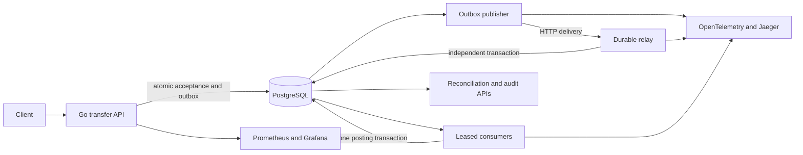

# LedgerFlow

**An asynchronous double-entry ledger with durable acceptance, duplicate-safe posting, and reproducible worker-crash recovery.**

LedgerFlow accepts synthetic USD transfer requests, publishes committed work through a transactional outbox, and posts balanced journals despite repeated deliveries and concurrent spending. This is a local production-style engineering exercise, not a payment service or evidence of real financial operations.

## Review in five minutes

1. Start: `make up`.
2. Submit and await real synthetic transfers: `make demo`.
3. Verify: `make test check build integration`.
4. Reproduce an unsafe duplicate-posting policy and its corrected behavior: `make incident ID=001`.
5. Crash a dedicated publisher and verify recovery: `make recovery`.

[Incident 002](incidents/002/problem.md) connects the uncertain-acknowledgement regression, actual publisher exit, persisted outbox evidence, and one resulting journal. See [verification](docs/verification.md) for measured results and limitations.

## Architecture



One Go binary runs separate API, relay, publisher, consumer, and initialization processes. A single PostgreSQL instance hosts the durable structures. The relay deliberately uses a distinct HTTP acknowledgement and database transaction; this exposes publication uncertainty without pretending to be Kafka or claiming independent database availability.

## Run locally

Prerequisites: Linux, Docker with Compose, Go 1.27.2+, Python 3, and Make. Available loopback ports: 55433 (database), 8090 (API), 8091 (relay), 9091 (Prometheus), 3301 (Grafana), and 16687 (Jaeger). Docker-only startup does not require a host Go installation; tests and incident harnesses do.

```sh
make setup
make up
make demo
curl http://127.0.0.1:8090/accounts
curl http://127.0.0.1:8090/journals
curl http://127.0.0.1:8090/reconcile
```

Three synthetic customer accounts (`alice`, `bob`, `carol`) each start with 100000 USD minor units. A system equity account balances these opening entries. No real money, bank account, customer, or external service is involved. The tracked `local_demo_only` password is an explicit public development value.

- Accounts: http://127.0.0.1:8090/accounts
- Reconciliation: http://127.0.0.1:8090/reconcile
- Audit: http://127.0.0.1:8090/audit
- Delivery status: http://127.0.0.1:8090/queue
- Dashboard: http://127.0.0.1:3301/d/ledgerflow
- Trace explorer: http://127.0.0.1:16687

`make down` retains the named PostgreSQL volume. A repeated `make up` does not reset balances. Initialization is idempotent and runs before application services. Demonstration commands create fresh idempotency keys; eventually insufficient funds are an expected rejected outcome if a caller repeatedly drains one account.

## Transfer contract

```sh
curl -i http://127.0.0.1:8090/transfers \
  -H 'Content-Type: application/json' \
  -H 'Idempotency-Key: first-local-transfer' \
  -d '{"from":"alice","to":"bob","amount_minor":25,"currency":"USD"}'
```

A **202** response means the request and its outbox event were committed. It does not mean funds moved. Follow the returned `Location` or query `/transfers/{id}` until `posted` or `rejected`. Reuse the same key and identical payload after an uncertain client response. Reusing it with different content returns **409**. Keys have no expiration in this release.

Amounts are signed integer minor-unit deltas in journals, with positive bounded int64 transfer amounts. There is no floating-point accounting, currency conversion, fee engine, real settlement, or user authentication.

## Correctness boundaries

- Every journal has at least two signed entries summing to zero, enforced by a deferred database constraint trigger. Transfer journals contain exactly two entries through the application path; opening funds use four.
- Posted journals/entries reject edits and deletes; new entries cannot be appended to a journal committed in an earlier transaction.
- Request idempotency, inbox identity, and one-journal-per-transfer uniqueness defend different replay boundaries.
- Posting locks both accounts in stable ID order, checks funds and destination limits, and commits inbox, journal, entries, balances, outcome, and audit together.
- Rejected transfers do not partially mutate balances or journals. Reconciliation compares cached balances against immutable entries in one repeatable-read snapshot.
- Relay delivery is at least once within the documented durable database boundary. Acknowledgement uncertainty can produce duplicate relay rows; consumer business effects remain idempotent. No exactly-once transport claim.
- Leases expire after worker crashes. A stale owner cannot acknowledge a lease reclaimed by another worker.
- Outbox work retries indefinitely with capped delay. Delivery failures stop after eight attempts in a durable dead-letter state; explicit operator retry is audited.

## Verification and incidents

```sh
make test check build integration
make incident ID=001
make incident ID=002
make incident ID=003
make recovery
```

An incident command succeeds only when its isolated unsafe policy fails for the expected reason and the corrected policy passes the same acceptance test. Unsafe legacy paths and altered-schema reenactments exist only in integration tests, never executable services. These are synthetic exercises, not historical customer outages.

`make recovery` uses a local Unix-socket Docker context, stops only this project's publisher/consumer, accepts committed work, launches a dedicated publisher that deliberately exits **77** after relay acknowledgement, then restarts normal workers. It verifies pending outbox retention, duplicate relay deliveries, one inbox record, one journal, exact transfer entries, and successful reconciliation. It restores workers in a finally block. Use the disposable local demo and avoid unrelated writers during fault setup.

| Incident | Failure | Evidence |
| --- | --- | --- |
| [001](incidents/001/problem.md) | Duplicate delivery causes duplicate business posting | [Unsafe failure and corrected pass](evidence/001-results.txt) |
| [002](incidents/002/problem.md) | Lost acknowledgement or publisher crash leaves publication uncertain | [Regression](evidence/002-results.txt), [real process crash](evidence/process-crash-recovery.txt) |
| [003](incidents/003/problem.md) | Concurrent stale snapshots overspend the source and drift cached balances | [Deterministic concurrency regression](evidence/003-results.txt) |

Tests use unique isolated schemas and fail when database access is missing. Randomized concurrent tests cover multiple fixed seeds and repeated delivery; finite samples are not universal concurrency proofs. [Measured benchmark](evidence/benchmark.txt) covers local request acceptance plus posting, excluding relay transport and queue-worker scheduling.

## Operational limits

Single physical database, trusted local clients, USD only, no HA, no automatic retention, and no production security certification. Owner-level database changes can bypass application protections; reconciliation detects many resulting accounting inconsistencies but is not a defense against a malicious database owner. Trace storage is ephemeral. Readiness checks database access; worker progress is assessed through backlog, audit, and traces.

Read [design](docs/design.md), [contracts](docs/contracts.md), [decisions](docs/decisions.md), [operations](docs/runbook.md), [security](docs/security.md), and [engineering review](docs/review.md). Original project code remains unlicensed by owner choice. Compiled dependency license texts appear in [third-party notices](docs/third-party-notices.md).
