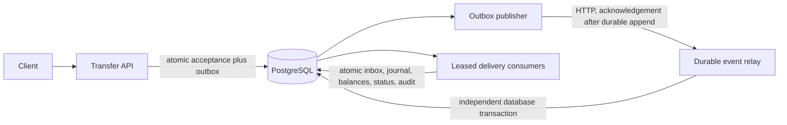

# LedgerFlow design

Status: actionable pre-implementation design. Implementation and measured evidence are not yet claimed.

## Problem, scope, and release boundary

Accept synthetic USD transfers and preserve double-entry correctness across repeated requests, duplicate event delivery, concurrent spending, and worker crashes. This local production-style system is not a payment processor and has no bank integrations or real money. First complete release: asynchronous transfer acceptance, transactional outbox, durable HTTP relay, idempotent posting workers, reconciliation, APIs, and three reproducible incidents.

## Architecture

One Go binary runs API, publisher, consumer, relay, or initialization modes. These are distinct processes because crash boundaries matter. They share one PostgreSQL instance in this release but operate through independent transactions. The relay is a small durable queue, not Kafka and not a claim of infrastructure diversity. Its HTTP boundary makes uncertain acknowledgements testable without imposing a heavyweight broker on a 16 GB workstation.

## Data model and API

- Accounts: synthetic ID, USD currency, signed integer minor-unit balance; customer balances must remain nonnegative. A system equity account funds opening balances.
- Transfer requests: UUID, idempotency key, canonical payload hash, source/destination, positive minor-unit amount, currency, state (`accepted`, `posted`, `rejected`), rejection reason.
- Outbox: immutable transfer event payload, event ID, lease token/deadline, attempts, retry time, publication acknowledgement time.
- Relay deliveries: independent append-only event identity/payload plus delivery status, attempts, lease and retry metadata. Duplicate event IDs are deliberately permitted at transport level.
- Consumer inbox: unique event ID, processed outcome and payload fingerprint.
- Journals and signed postings: two entries per transfer, debits represented by negative account delta and credits by positive delta. Every journal sums to zero. Opening balances are balanced against system equity.
- Audit: structured accepted, posted, rejected, retried, and dead-letter transitions without personal data.

`POST /transfers` requires `Idempotency-Key` and `{from,to,amount_minor,currency}`. It returns 202 for a durable accepted request, not a successful posting. Reusing a key with different content returns 409; same content returns the existing request. Invalid syntax or unknown accounts returns 400. `GET /transfers/{id}` exposes eventual outcome. `GET /accounts`, `/journals`, `/audit`, `/reconcile`, `/health/live`, `/health/ready`, and `/metrics` support inspection.

Amounts use int64 with explicit positive request bounds and account balance bounds to prevent overflow. Binary floating point is never used for money. Currency conversion, fractional minor units, fees, refunds, and real payments are outside scope.

## State and transaction boundaries

API acceptance inserts request, outbox, and accepted audit in one transaction. Concurrent idempotency requests converge through a uniqueness constraint and canonical-payload comparison.

Publisher claims an outbox lease with `FOR UPDATE SKIP LOCKED`, commits the claim, sends to the relay with a timeout, and marks publication only after a durable relay acknowledgement. A crash after relay commit but before marking publication causes a retry and duplicate delivery. Owner-qualified lease updates prevent a stale worker from acknowledging another worker's claim.

Consumers similarly claim delivery leases. Posting locks the transfer and then both account rows in deterministic account-ID order. It checks inbox identity, request/event agreement, balance availability, and destination overflow. A successful posting inserts inbox, journal, immutable entries, account updates, request status, and audit in one transaction. Rejection persists a terminal request outcome without partial ledger mutation. A crash between posting commit and delivery acknowledgement replays safely.

Database constraints provide independent defense: unique journal per transfer, unique inbox event, signed nonzero entries, deferred journal balance/count validation, and triggers prohibiting updates/deletes or adding entries to a journal created by an earlier transaction. Account cached balances are reconciled against immutable entries; database-owner tampering is outside the trust boundary and detectable as drift where applicable.

## Recovery and failed events

Leases expire and can be reclaimed after a worker crash. Retry uses bounded exponential delay. Transient database/transport failures preserve pending outbox work. Permanent malformed or unregistered events are dead-lettered with a precise reason. Repeated delivery failures reach a documented attempt limit and retain a dead-letter record for explicit operator retry. No committed outbox event is silently deleted. No exactly-once transport claim.

## Security and observability

Loopback-only host ports, synthetic fixtures, runtime environment configuration, parameterized SQL, HTTP payload/timeout limits, unprivileged containers, and read-only CI permissions. Trusted local API/relay publishers only; no authentication or bank-grade security claim. Fault injection requires explicit local-demo opt-in and is never enabled by default. No cloud services or paid dependencies.

JSON logs and OpenTelemetry spans link request, transfer, event, lease, and outcome. Prometheus metrics expose acceptance, processing latency, durable queue backlog, and dead-letter counts without unbounded account/event labels. Audit records are durable business evidence; logs/traces are supplementary.

## Verification strategy

Unit: strict request/event validation, amount overflow boundaries, canonical idempotency identity, and retry bounds. PostgreSQL: concurrent same-key acceptance, conflicting keys, journal balance/immutability constraints, transaction rollback, idempotent consumption, lease ownership/expiry, reconciliation, rejected transfer isolation, and concurrent spending. Real Compose: API → publisher → relay → consumer; actual publisher process exit after relay acknowledgement; normal restart and duplicate-safe recovery.

Incident 001: replay without durable idempotency barriers demonstrates duplicate accounting effects; corrected inbox plus journal uniqueness permits one business posting. Unsafe legacy behavior exists only in an isolated test schema.

Incident 002: crash a real publisher after relay receipt and before marking outbox completion. Verify pending committed work remains, relay can contain duplicates, and one balanced journal is posted after recovery.

Incident 003: coordinate two stale balance reads in a deterministic legacy transfer path, demonstrate overspend/account-cache drift, then run the account-locked implementation and verify one posting plus one rejection.

For every incident: captured intended failure, corrected pass, precise acceptance commands, root cause, source evidence, and genuine commits. Benchmarks state local workload and exclude transport where not measured. Reconciliation independently compares account caches, journal balance, and request/journal correspondence.

## Acceptance criteria

1. Fresh Compose startup and documented API demonstration work without paid services.
2. Every committed journal has at least two entries and total signed amount zero.
3. Posted entries cannot be changed, deleted, or extended after commit.
4. Same-key requests and repeated deliveries produce one business posting; conflicting reuse is rejected.
5. Rejected operations leave account balances and journal state unchanged.
6. Concurrent spending preserves customer nonnegativity and cache-to-journal reconciliation.
7. Worker crashes reclaim expired leases and never silently discard committed pending requests.
8. All three incident reproductions and corrected regressions pass their harnesses; wider checks pass.
9. Documentation, measured evidence, dependency/secret checks, and review agree with implementation.
10. Private GitHub CI passes before public publication is separately approved.

## Trade-offs and known limits

Single physical database is an availability dependency for all components. This is not a geographically distributed payment network. The durable relay demonstrates transport acknowledgement boundaries but does not reproduce every Kafka failure mode. Local trusted clients, USD only, explicit synthetic opening funds, no automated data retention, and finite workload verification. Permanent database misconfiguration requires operator repair. Initial DDL is idempotent; general schema version upgrades need later migration tooling. Keep FactoryMesh stopped during heavy LedgerFlow verification if memory pressure arises.
